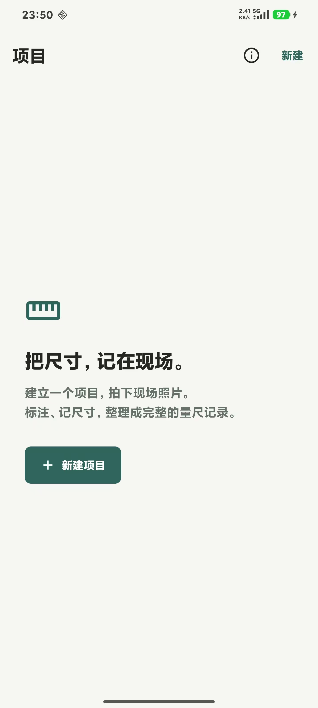
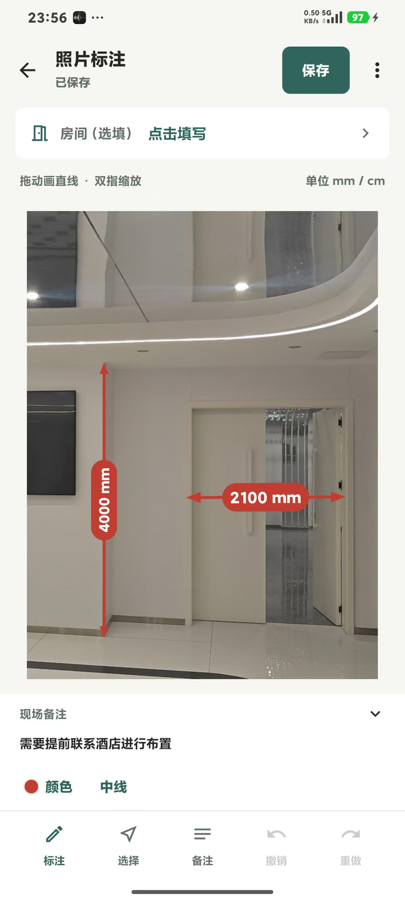
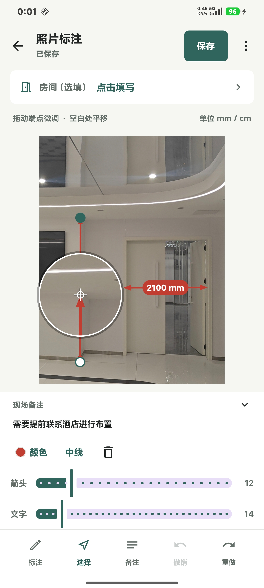
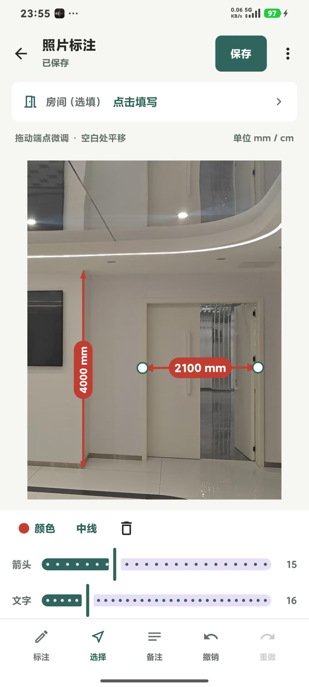
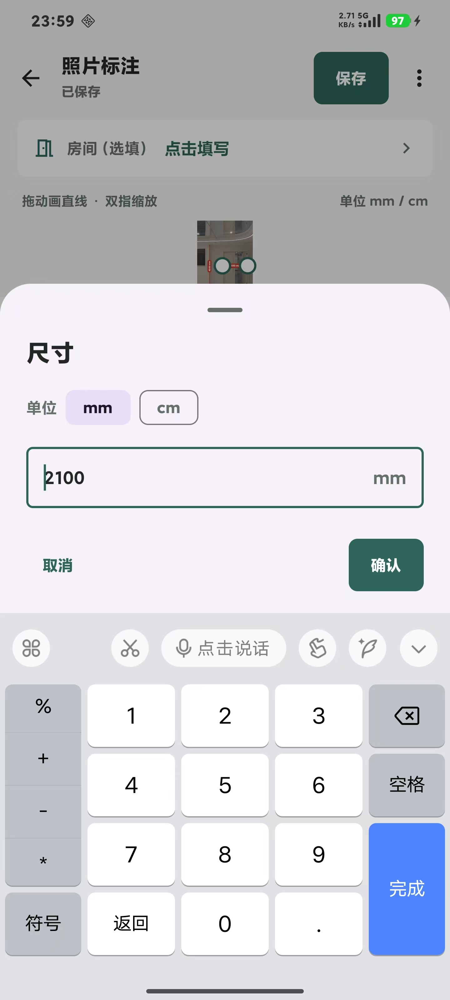
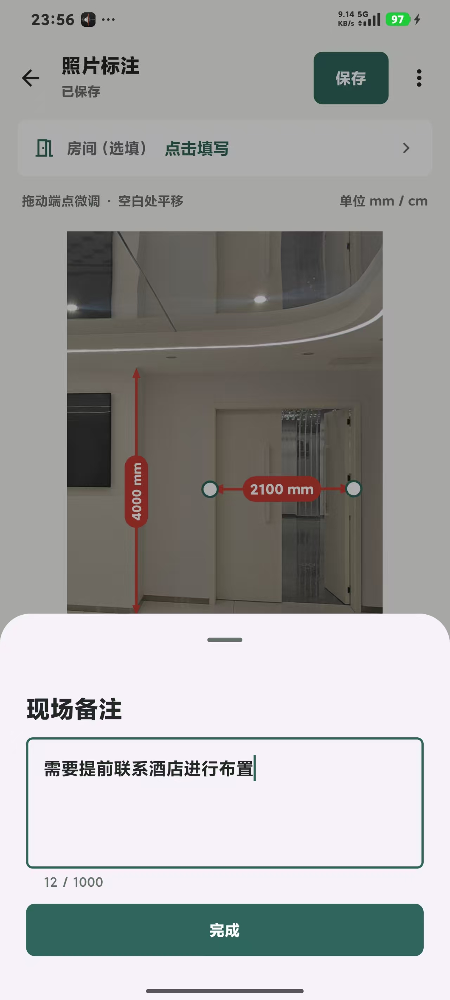
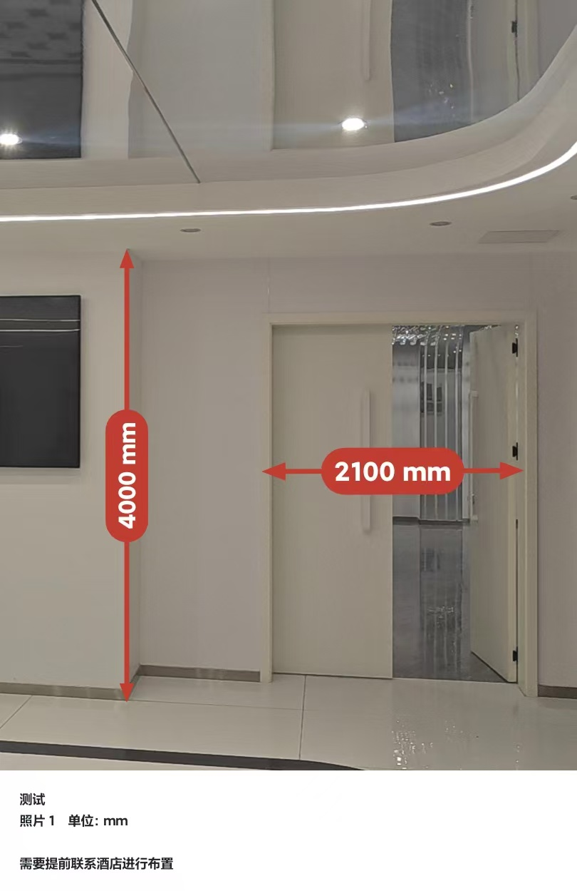

**简体中文** | [English](./README_en.md)

# MeasurePhoto · 拍照快标

[](https://github.com/guojin-lab/PhotoQuickMark/actions/workflows/android.yml)
[](LICENSE)

一款**完全离线**的 Android 工具：在现场照片上记录**人工实测的尺寸**，再导出带标注的图片和 PDF。基于 Kotlin、Jetpack Compose、Room 与 CameraX 构建，支持 Android 10 及以上，界面为简体中文。

> **照片本身不会测量真实尺寸。** 数值必须来自卷尺或激光测距仪的实测结果；修改数值不会让已画的线段重新缩放。

本项目是基于开源项目 [Lsama666/measure-photo](https://github.com/Lsama666/measure-photo) 的**二次创作**版本，现由 [guojin-lab](https://github.com/guojin-lab) 维护，当前版本 **1.0.0**。

## 核心特性

### 标注与测量

- **尺寸线绘制**：拖动画出直线，共享端点自动吸附，选中后可单独拖拽任一端点微调。
- **局部放大镜**：标注或拖动端点时，手指上方浮现 2 倍放大区域，实时显示原图、已有标注和进行中的线条；命中吸附点时标记变绿，避免被手指遮挡。
- **实心胶囊标签**：数值标签是随线段方向旋转的实心胶囊，居中压在线段中点之上；第二遍绘制保证胶囊覆盖所有穿过的线条，交叉处依然可读。标签按双指缩放反向补偿，**放大照片时字号在屏幕上保持恒定**，超出照片宽度的长数值会保留胶囊、自动收缩字号。
- **实心箭头端头**：线段两端为实心箭头，笔画在箭头底部截断，不会穿透尖端。
- **逐条线独立微调**：选中某条线后出现「箭头」与「文字」两根滑杆，分别调整这条线的箭头大小和标签字号，拖动时实时预览、松手生效，只影响当前这条线。
- **mm / cm 单位**：按 `DimensionUnit` 切换毫米或厘米，输入框后缀与导出记录同步标注单位。
- **标注后自动填写尺寸**：可在「标注设置」中开关；关闭后改为点击线条或标签再填写，取消输入不会删除已画的线。
- **全局样式与历史**：线条颜色、线宽（细 / 中 / 粗）在工具条上选择，作用于当前画笔或选中线；支持撤销与重做。

### 数据与导出

- **项目化管理**：新建项目，拍照或批量导入照片，可为每张照片标注房间名（30 字内）与备注（1000 字内）。
- **原图与标注分离**：原始照片不动，标注数据以本地 Room 数据库保存，可随时回到编辑器继续修改。
- **两种导出**：通过 MediaStore 导出带标注的图片到相册，以及多页 PDF。批量导出留有记录，中断后的未完成项可在「导出记录」中重试，已完成的相册图片保留。
- **EXIF 方向感知**：按照片 EXIF 旋转信息正确渲染，避免横竖屏错位。
- **内存可控**：大批量导出时对图片降采样，尺寸文字与线条仍按矢量绘制，不会被压缩糊掉。

### 隐私

无账号、无服务器、无统计 SDK、无广告，应用清单中**不申请 `INTERNET` 权限**，所有数据留在本机。

## 适用人群

需要便携现场记录的安装师傅、室内设计师和小型加工/施工班组。可复用的工程点包括归一化几何、标签避让、EXIF 感知渲染、共享端点与内存受限的批量导出。

## 使用流程

新建项目 → 拍照或导入 → 用「标注」拖出尺寸线 → 填写实测数值 → 保存 → 导出图片或 PDF。

## 构建与测试

请将仓库克隆到**本地、非网盘同步**的目录。需要 JDK 17 与 Android SDK Platform 35 / Build Tools 35.0.0，并设置 `ANDROID_HOME`（或写一个不纳入版本控制的 `local.properties`，内容为 `sdk.dir=<SDK 路径>`）。

```sh
./gradlew assembleDebug testDebugUnitTest lintDebug assembleDebugAndroidTest
```

Windows 下使用 `gradlew.bat`。Gradle 8.11.1 由 wrapper 下载并做校验和验证；AGP 锁定 8.9.2，Kotlin 锁定 1.9.25，Compose 编译器锁定 1.5.15。拉取构建依赖需要联网，**应用本身完全离线运行**。

APK 产物位于 `app/build/outputs/apk/debug/app-debug.apk`。CI 会把 debug APK 与测试报告作为 workflow 制品发布，下载需要登录 GitHub。Debug 构建仅用于评估，不是应用商店发布版本，且不同 CI 机器的签名密钥可能不同。

在可随意处置的测试机或模拟器上执行设备测试：

```sh
./gradlew connectedDebugAndroidTest
```

100 张照片的负载测试需要显式开启，见 [测试说明](docs/TESTING.md)。提交缺陷报告时请勿附带客户真实照片。

## 预览与当前限制

以下均为 **v1.0.0 真机截图**。画面中的现场照片是真实量尺记录，仅用于展示界面效果。

<table>
  <tr>
    <td></td>
    <td></td>
    <td></td>
    <td></td>
  </tr>
  <tr>
    <td></td>
    <td></td>
    <td></td>
  </tr>
</table>

v1.0.0 相对早期版本的变化：移除了标签的白色底衬，胶囊改为随线段方向旋转并压在线段之上；新增逐条线的箭头 / 文字滑杆与标签缩放补偿；工具名从「画线」改为「标注」。

在正式依赖本应用前，请先阅读[验证情况与遗留缺口](docs/TESTING.md)。暂无 iOS 版本。完整的人工设备覆盖、导出中断后的恢复、以及低内存机型的适配仍属未完成工作。

## 参与贡献

参见 [CONTRIBUTING.md](CONTRIBUTING.md)、[路线图](docs/ROADMAP.md) 与[安全策略](SECURITY.md)。中英文提案都欢迎，所有改动由维护者审核。可以使用 AI 辅助，但生成的改动同样需要测试与评审。

## 开源许可

本项目以 [MIT License](LICENSE) 发布。上游 [Lsama666/measure-photo](https://github.com/Lsama666/measure-photo) 同样采用 MIT 许可，其版权声明按许可要求保留在 `LICENSE` 中。依赖项保留各自许可证，见[第三方声明](THIRD_PARTY_NOTICES.md)。
